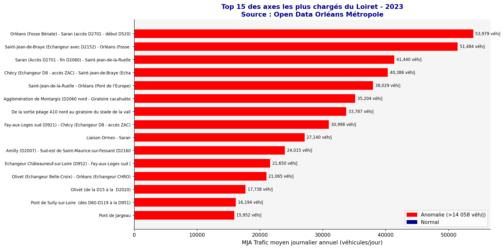

# 🚦 Analyse du trafic routier - Département du Loiret

Pipeline Python + tableau de bord Power BI qui transforme les données brutes de **617 stations de comptage** en indicateurs de pilotage : axes les plus chargés, part de poids lourds, anomalies de comptage.

## Résultats
- **617** points de comptage analysés (données ouvertes 2023)
- Axe le plus chargé : **53 979 véhicules/jour**
- **17 anomalies** détectées automatiquement (seuil ±2σ)
- Part moyenne de poids lourds : **6,5 %** ; identification des axes logistiques

## Démarche
1. Nettoyage et fiabilisation (types, identifiants, valeurs manquantes)
2. Classement des axes par trafic moyen journalier annuel (MJA)
3. Analyse par catégorie de réseau
4. Détection d'anomalies et axes à forte part de poids lourds
5. Carte interactive (Folium) : `outputs/carte_trafic_orleans.html`
6. Restitution Power BI : `Visualisation_Power_BI/` (screenshots ci-dessous)

## Stack
Python (pandas, NumPy, matplotlib, seaborn, folium) · Power BI · Jupyter

## Lancer
Placer `TRAFIC_POINT_2023.xlsx` dans `data/` puis exécuter `notebooks/01_analyse_exploratoire_trafic_orleans.ipynb`.

## Limites
Détection ±2σ simple (distribution asymétrique) · valeurs manquantes de poids lourds à traiter explicitement plutôt que remplacées par 0 · une seule année de données.

**Célestine LENO** - [LinkedIn](https://www.linkedin.com/in/celestineleno)
